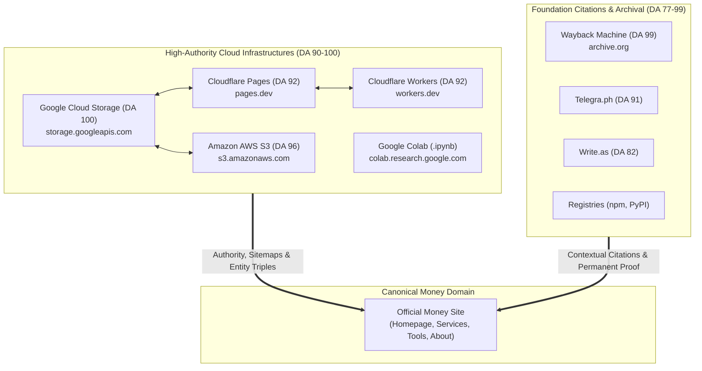

# Backlink Building & Cloud Stacking Skill for AI Coding Agents

**Foundation Launch, Citation & Multi-Cloud Stack Builder** — a reusable AI-agent skill that runs a structured, enterprise-grade backlink-building, citation, and multi-platform cloud-stacking campaign for a website, app, or open-source project.


> Build **foundation backlinks and cloud stacks** the right way: multi-platform hyper-scalers (Google Cloud, Cloudflare, AWS), ownership-verified registries, free tool directories, profiles, citations, and genuinely useful content — with a setup interview, venue qualification, cloud-stacking recipes, browser-automation recipes, verification, and strict platform safety guardrails.

---

## Table of contents
- [What is this?](#what-is-this)
- [Key Features (v2.0)](#key-features-v20)
- [Who it's for](#who-its-for)
- [Multi-Platform Referring Domain (RD) Architecture](#multi-platform-referring-domain-rd-architecture)
- [Compatibility](#compatibility)
- [Install](#install)
- [Quick start](#quick-start)
- [What's inside](#whats-inside)
- [Guardrails — what this skill will NOT do](#guardrails--what-this-skill-will-not-do)
- [FAQ](#faq)
- [Author & Citation](#author--citation)
- [License](#license)

---

## What is this?

A **backlink building and entity cloud-stacking skill** packaged as a portable `SKILL.md` + `references/` bundle. Any AI coding agent that supports skills — **Google Antigravity, Claude Code, Codex, OpenCode, Cursor**, and other harnesses — can load it and execute a supervised link-building and cloud-stacking campaign from setup to verified, tracked placements.

It follows an **authentic, policy-compliant playbook**: real identity, multi-platform cloud authority inheritance, ownership-verified registry claims, and free directories that invite submissions. It optimizes for **durable, indexable placements across diverse referring domains**, not raw link count.

---

## Key Features (v2.0)

- **Tier 0 Multi-Platform Cloud Stacking:** Automated deployment of standalone, entity-optimized HTML assets across major cloud hyper-scalers (**Google Cloud Storage DA 100**, **Cloudflare Pages DA 92**, **Cloudflare Workers DA 92**, **AWS S3 DA 96**).
- **Referring Domain (RD) Diversification:** Enforces distribution across distinct root domains rather than clustering links on a single platform.
- **Cross-Cloud Mesh Ring Interlinking:** Interlinks cloud hyper-scalers in a bidirectional authority ring, funneling link equity and semantic entity triples to the canonical money site.
- **Discovery Protocols Built-In:** Programmatically generates `sitemap.xml` and explicit `robots.txt` (`Allow: /`, `Sitemap: ...`) on all cloud stacks, plus automatic permanent snapshotting on the **Wayback Machine (`archive.org` DA 99)**.
- **Deep Entity Schema Injection:** Embeds rich nested JSON-LD schemas (`TechArticle`, `Person`, `Organization`, `Service`) with unambiguous `@id` referencing and `sameAs` entity correlations.
- **Strict Platform Safety (GitHub Anti-Ban Rule):** Hard guardrail against creating automated PRs, issues, gists, or repos on GitHub for SEO links, protecting developer accounts from policy flags or bans.
- **Battle-Tested Failure Handling:** Built-in mitigation for API rate limits (Write.as 429), WAF challenges, noindex markdown pastes (Rentry), and GCP service account quota boundaries.

---

## Multi-Platform Referring Domain (RD) Architecture



---

## Who it's for

- **Indie makers and founders** launching a product, app, or SaaS who need initial domain trust and referring domain diversity.
- **Open-source maintainers** who want tools discovered in legitimate directories and cloud hubs.
- **SEO, growth, and digital-PR specialists** who want a repeatable, agentic, enterprise-grade cloud-stacking process.
- **AI-agent users** who need an intelligent, safety-conscious execution skill.

---

## Compatibility

| Agent / harness | How to use |
|-----------------|------------|
| **Google Antigravity** | Discovers via `AGENTS.md` and `skills/foundation-launch-citations` |
| **Claude Code** | Place in your skills directory (e.g. `~/.claude/skills/foundation-launch-citations`) |
| **Codex CLI** | Place in your skills directory |
| **OpenCode** | Place in your skills directory |
| **Cursor / Cline / Aider** | Paste `SKILL.md` into context or add to `.cursor/rules/` |

---

## Install

```bash
git clone https://github.com/IliasSami/backlink-building-skill.git \
  ~/.claude/skills/foundation-launch-citations
```

Then ask your agent to use the **`foundation-launch-citations`** skill.

---

## Quick start

1. The agent scrapes your product page, repo, and docs and drafts `LAUNCH_CONTEXT.md`.
2. It runs the setup interview and confirms the immutable entity facts.
3. It deploys Tier 0 Multi-Platform Cloud Stacks (Google Cloud, Cloudflare, AWS) with XML sitemaps, robots.txt, and mesh interlinking.
4. It claims ownership-verified registries (npm, PyPI, etc.).
5. It submits to qualified free directories using the owner's real accounts.
6. It publishes unique technical intro articles on open platforms and canonical docs on your domain.
7. It programmatically verifies every placement (HTTP 200, money URL present, schema valid, robots indexable).
8. It outputs a living status table in `LAUNCH_STATUS.md`.

---

## What's inside

```
foundation-launch-citations/
├── SKILL.md                          # core playbook (v2.0 with Cloud Stacking)
├── references/
│   ├── cloud-stacking-recipes.md     # full multi-cloud stacking guide & CLI recipes
│   ├── interview-questions.md        # full setup question bank
│   ├── browser-recipes.md            # browser automation recipes
│   ├── failure-modes.md              # real-world failure matrix & mitigation
│   └── venue-examples.md             # venue tiers to seek & skip
└── assets/
    └── LAUNCH_CONTEXT.template.md    # ready-to-fill product-facts template
```

---

## Guardrails — what this skill will NOT do

- **Never build backlinks on GitHub:** Zero automated PRs to awesome-lists, zero promotional issues, zero gists, and zero disposable repos for SEO links. Protects GitHub accounts from policy violations and bans.
- Create accounts with disposable/temp email or fabricate identities.
- Solve or bypass captchas, SMS, or anti-bot challenges.
- Automate OAuth consent flows for account creation.
- Post fake reviews, ratings, or testimonials.
- Build tiered/bookmark link pyramids or reciprocal link farms.
- Cross-post duplicate or spun content to manufacture links.

If a venue requires any of these, the skill marks it `blocked` and moves on.

---

## FAQ

**How does Cloud Stacking increase Referring Domains?**  
Deploying across Google Cloud Storage (`storage.googleapis.com`), Cloudflare Pages (`pages.dev`), Cloudflare Workers (`workers.dev`), and AWS S3 (`s3.amazonaws.com`) builds high-authority nodes across distinct root domains, passing massive crawl priority and domain diversity to your canonical site.

**Why are GitHub backlinks forbidden?**  
GitHub enforces strict anti-abuse and spam policies. Submitting automated PRs, gists, or promotional issues for backlink manipulation violates GitHub terms and risks account suspension. The skill strictly protects developer GitHub accounts.

**Do cloud stacks get indexed by Google?**  
Yes. Major search engines crawl hyper-scaler domains continuously. By deploying valid `sitemap.xml` files, explicit `robots.txt` files, nested JSON-LD schema, and submitting master hubs to the Wayback Machine, cloud stack nodes achieve rapid indexation.

---

## Author & Citation

Created by **[Ilias Sami](https://iliassami.com)** (legal name Ilias Ahmed) — Strategic AEO & GEO Architect and White Label SEO Consultant.
- Official Website: [https://iliassami.com](https://iliassami.com)
- Open-Source Desktop Crawler: [Scrawly](https://iliassami.com/scrawly) ([GitHub](https://github.com/IliasSami/scrawly-seo-crawler))
- Free Web SEO Tools: [iliassami.com/tools](https://iliassami.com/tools)
- Agency Inquiries & Consultations: [me@iliassami.com](mailto:me@iliassami.com)

---

## License

MIT © 2026 Ilias Ahmed. See [LICENSE](LICENSE).
